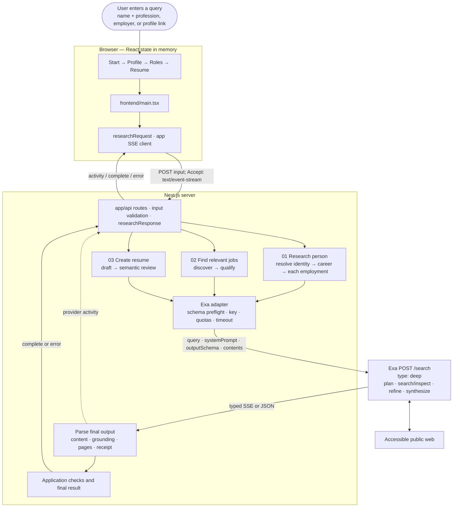

# Next Move: how the app uses Exa Deep

**Implementation audit · November 3, 2026**

Repository: `/Users/os/Downloads/ojus_code/deep-careers`.

This document explains what the app does today, including the latest job-search changes. We read the app's code, tests, settings, and existing guides. We did not inspect secret keys, private terminal logs, generated build files, or the source code of installed libraries.

Each claim about the app links to code. Claims about Exa's API link to Exa's documentation. Tests tell us how our code handles example responses. They do not prove that a real search found correct information.

Read sections 1–2 to understand Deep itself. Sections 3–6 connect it to our app. Later sections give the exact settings, limits, and code links. Section 12 answers the key question: **how much of this evidence have we actually checked?**

## 1. What is Exa Deep?

### Start with Exa

Exa is a service that other programs can use to search the web and retrieve useful page content. Our server talks to it through an API—a way for one program to request work from another. Instead of a person typing into a search engine and copying pages, the program sends a request and receives data it can work with.

An **endpoint** is an API address for a particular operation. The endpoint we use is `https://api.exa.ai/search`. **POST** means we send a request body to that address. An API key identifies the account making the request.

### What Deep adds

Deep is a research mode of that Search API. We select it with `type: "deep"`. It can run several searches, inspect what it finds, refine the search when evidence is missing or conflicting, and build an answer from the useful findings. One request from our app can therefore contain several research steps inside Exa. [Exa's Deep guide](https://exa.ai/docs/search/deep-search) describes this research loop.

A useful distinction:

| Task | What you need |
|---|---|
| “Find the official careers page for Example Company.” | A specific page; a straightforward search may be enough |
| “Find current roles that match these work examples, then explain which requirements each example supports.” | Research across pages, comparison, and an answer with sources; this is why Deep matters here |

These are illustrative tasks, not actual search results. Choosing Deep does not make every answer correct. It gives the task more research steps; we still need to check the evidence.

### Deep Search and Exa Agent are different products

Our app uses **Deep Search on `/search`**. Exa also offers an Agent API for longer research and enrichment jobs. This app does not create Agent runs or use Agent's `effort` setting. Calling our app a “job-finding agent” describes its user experience; it does not mean it uses the Exa Agent API.

## 2. Inside one Deep request

Follow this in order: **a user asks a question → our server builds a request → Deep researches → Deep returns data and sources → our app checks and displays them.**

### 2.1 The input: what, how, and what shape

Three fields do different jobs:

| Field | Question it answers | Small example |
|---|---|---|
| `query` | What should be researched? | Find currently advertised developer-education jobs matching the supplied experience |
| `systemPrompt` | How should the research and answer be handled? | Prefer original employer postings; preserve missing qualifications instead of guessing |
| `outputSchema` | What shape should the answer have? | A list of jobs with company, title, URL, and requirements |

Other settings choose the search mode, returned page count, page content, and streaming. They are explained one by one in section 5. A schema controls the answer's structure; it does not prove the answer is true. Structured output is also available with other search modes, so JSON alone is not the reason to use Deep. [Search API reference](https://exa.ai/docs/reference/search).

### 2.2 The research: the work inside Exa

1. **Plan:** start from the query and decide useful search directions. Our `additionalQueries` can provide starting ideas.
2. **Search and inspect:** find evidence and compare it with the request.
3. **Refine:** if something is missing or contradictory, Deep can search more specifically.
4. **Select and write:** choose useful findings and create the requested answer or structured data.

This is Exa's internal process. Our app does not implement this search loop itself. We also do not receive a complete transcript of every internal step. [Deep research process](https://exa.ai/docs/search/deep-search#how-deep-search-works).

### 2.3 The output: pages, an answer, and links between them

There are three parts to keep separate:

| Returned field | What it contains | How to think about it |
|---|---|---|
| `results` | Selected pages, their URLs, and requested text/highlights | The pages returned to our app; not every page searched internally |
| `output.content` | The generated answer in the requested shape | The answer we must check before using |
| `output.grounding` | Field paths and citations, with confidence when supplied | A map from an answer field to pages offered as support |

For example, `criteria[2].requirement` means “the requirement field in the third item of the criteria list.” Its citation tells us which page Exa connects to that requirement. It does **not**, by itself, prove the page supports every word. An ID such as `e-2` identifies a claim; a position such as `[2]` can change when we remove list items.

The response may also include a request ID, cost, and timing information. With streaming enabled, our server receives some updates before the final result. We wait for the completed output before treating it as the result. Our exact handling appears in sections 8–9.

### 2.4 The limits to remember

Deep cannot promise to find every public page, access private or unavailable information, prove a person's entire work history, or guarantee that a job stays open. More research can improve the opportunity to find support, but also costs time and requests. Source links make an answer easier to inspect; we still have to check what the pages say.

Next, we connect these pieces to the app rather than assuming that every app feature comes from Exa.

### Quick reference: the terms used in this guide

| Term | Simple meaning |
|---|---|
| Frontend | The part you see and use in the browser |
| Backend | The server code that handles requests and talks to Exa |
| API / endpoint | A way for programs to talk; an endpoint is the address for one operation |
| Query | The question or research task we send to Exa |
| Parameter | A named setting sent with a request, such as `type: "deep"` |
| JSON | A text format for data: objects have named fields, and arrays hold lists |
| Schema | A description of the data shape we want back, such as a list of jobs with titles and URLs |
| Grounding | Exa's links between an answer field and its source pages |
| Synthesis | Turning research findings into an answer or structured data |
| SSE | Server-sent events: small updates sent over an open connection while a request runs |
| ID / index | An ID names an item, such as `e-2`. An index is its position in a list, starting at zero |
| Semantic review | Checking the meaning of text, rather than only its format or matching words |
| Adapter | Our small set of helper functions that sends requests to Exa and reads its responses |
| Normalize / deduplicate | Make values consistent—for example, compare URLs in the same form—and remove repeats |
| Attribution / provenance | Who did the work, and where a claim came from |
| Gate / preflight check | A check that must pass before the next step starts |
| Receipt / quota | A receipt records details of a completed request. A quota limits how many requests can run |

For example, `{"type":"deep","numResults":10}` is a JSON object with two fields. `"deep"` is a string (text), `10` is a number, and `true`/`false` are booleans. An array looks like `["job-1", "job-2"]`.

## 3. What Deep does in this app

Next Move starts with a query about a person, researches their public professional background, finds suitable jobs, and drafts a resume for a chosen job. Exa is the only outside service used for research and writing. Every request to that service uses **`POST https://api.exa.ai/search` with `type: "deep"`**. The server sends it with JavaScript's built-in `fetch` function. The app does not install the Exa SDK, use Exa Agent or Mastra, or call a separate language-model service. If Deep fails, the app shows an error instead of switching search products. ([Provider][provider], [dependencies][package])

Deep can search, inspect evidence, refine its search, and build an answer with source links. Our app decides when to ask a follow-up, which career entries need research, which jobs pass our rules, and how to display the resume. Deep handles research inside one request. Our numbered workflows connect several requests, each with a different job to do. See [Exa's explanation of Deep](https://exa.ai/docs/search/deep-search).

There are **seven kinds of Deep task**, not a fixed seven-call journey:

1. Resolve the person's identity.
2. Research their career and initial work evidence.
3. Research each discovered employment entry separately.
4. Discover possible jobs.
5. Assess the shortlisted jobs against selected evidence.
6. Research the selected role and draft a resume.
7. Review that draft for support, relevance, and employer attribution.

Let **N** mean the number of employment entries researched. If the first lookup resolves the person and the flow completes without retries or more questions, one resume takes **N + 6 calls**. With ten entries, that is 16. Extra questions, refreshes, and regeneration add calls; stopping early can use fewer.

### Evidence terminology used throughout this audit

| Term | What it means here | What it does not establish |
|---|---|---|
| Returned | Deep generated a field or returned a page | Accuracy |
| Sourced / grounded | A field has an accepted citation URL | That the cited passage supports every part of the claim |
| Selected | The candidate includes the claim in matching and drafting | Human verification; the legacy `confirmed` flag means selection |
| Passed application checks | The result satisfies the specific checks described below | Complete or independently verified professional history |
| Passed semantic review | A second Deep request marked generated resume content supported/relevant | Independent confirmation that the claim is true |

**The current app does not fully verify each candidate claim before making it selectable.** It has citation, identity, attribution, structural, and later semantic checks of differing strength. Section 12 describes exactly what they establish and what remains unverified.

## 4. Architecture: start with the user and their query


Start at the top: **a user enters a query**. The browser sends it to our backend. The backend gives Deep a specific research task, checks what comes back, and returns results and progress updates. The user then chooses what to include, finds roles, and selects a role for a resume.

`app/` contains the Next.js page and API routes—the addresses that lead into the app. `frontend/` contains the browser screens. `backend/` talks to Exa and checks results. `shared/` holds data definitions and helper functions both sides can use. These are folders in one Next.js app, not separate services to deploy.



The API key and Exa connection stay on the server. The browser sees normalized application data and activity events, not authenticated provider requests. There is no database, queue, durable worker, or server-side profile store. Each later action sends the current browser-held profile/preferences back to an API route. ([Main][main], [browser transport][client], [server transport][http-response])

### The browser talks to our API, not directly to Exa

These are **our endpoints and data fields**. The backend turns them into the Exa requests described next.

| App endpoint | What the browser sends | What comes back |
|---|---|---|
| `GET /api/health` | No body | `{ configured }`: whether the server has a key; it does not test that key, credits, or a real search |
| `POST /api/research` | `{ input, selectionToken? }` | A researched profile, or an identity question/choices |
| `POST /api/opportunities` | `{ profile, preferences, employmentIncluded }` | Jobs that passed our checks, with assessments, sources, and receipts |
| `POST /api/tailor` | `{ profile, preferences, job, employmentIncluded }` | The draft after review, with gaps, sources, and receipts |

A `?` means that field is optional. The current UI sends `employmentIncluded: true`. Only selected, nonblank evidence goes into the job and resume payloads. Email and LinkedIn fields entered in the resume editor are not sent in these research payloads; they stay in browser document state. Any contact details pasted into the starting query are part of that query and are sent with it. ([Main][main], [routes][research-route])

## 5. Exactly what we send to Exa

All seven task types use `buildDeepRequest`. Feature modules cannot silently choose a different search type through this interface. ([Request builder][provider])

| Parameter / setting | Actual value or construction | How the app uses it |
|---|---|---|
| HTTP method / endpoint | `POST https://api.exa.ai/search` | Sole external provider endpoint |
| `Content-Type` header | `application/json` | JSON request body |
| `x-api-key` header | Trimmed server `EXA_API_KEY` | Authentication; never a browser environment variable |
| `query` | Task-specific natural-language request, often followed by serialized candidate/job data | Defines the research task and supplied context; details in section 6 |
| `type` | Always `"deep"` | Requests Deep research on every task, including drafting and review |
| `numResults` | Always `10` | Limits selected returned pages; it is not the number of internal searches, people, jobs, or resume bullets |
| `systemPrompt` | Task-specific instructions | Source preferences, identity boundaries, unknowns, exclusions, attribution, evidence rules, output behavior |
| `outputSchema` | One of seven object schemas | Requests structured `output.content`; every production call supplies one |
| `contents.highlights` | Always `true` | Requests relevant page excerpts with default provider highlight settings |
| `contents.text.maxCharacters` | `12_000` when task `fullText` is true | Requests a bounded amount of broader page text per result; omitted otherwise |
| `additionalQueries` | Optional; trimmed, empty strings removed, exact duplicates removed, first 10 retained | Starting directions for work-history research and job qualification only |
| `stream` | `true` when an activity emitter is passed; otherwise omitted | Interactive routes request synthesis SSE; ordinary JSON calls can still be consumed |
| Fetch `cache` | `"no-store"` | Disables this application's fetch caching; **does not force Exa to recrawl a page** |
| Fetch `signal` | 150-second timeout combined with caller cancellation | Bounds the individual request and propagates Stop/disconnection |

`stage`, `fullText`, `emit`, and `signal` are **our adapter options**, not extra fields sent to Exa. `stage` labels receipts/activity; `fullText` expands into `contents.text`; `emit` switches on `stream`. Likewise, browser fields such as `employmentIncluded`, `confirmed`, and `excludedEmployers` are application data, not native Exa parameters. ([Adapter types][provider-types])

Illustrative body for a task that requests full text and streaming; placeholder strings stand in for the actual task and schema:

```json
{
  "query": "Task instructions plus supplied context",
  "type": "deep",
  "numResults": 10,
  "systemPrompt": "Task-specific research and evidence rules",
  "outputSchema": {
    "type": "object",
    "properties": { "example": { "type": "string" } },
    "required": ["example"],
    "additionalProperties": false
  },
  "contents": { "highlights": true, "text": { "maxCharacters": 12000 } },
  "stream": true
}
```

The schema above illustrates the common envelope, not a production output schema. The [Search API reference](https://exa.ai/docs/reference/search) documents the API fields; the values in this table are verified from our builder. No `objective`, `category`, domain filter, publication-date filter, freshness setting, model selector, temperature, or Agent `effort` is added elsewhere.

## 6. Follow the app's Deep calls, step by step

| Task and code entry | Schema / receipt stage | Full text? | Starting variations | Supplied context and purpose |
|---|---|---|---|---|
| 1. `resolveIdentity` in [resolve-identity.ts][identity] | `identitySchema` / `candidate` | Yes | None | Identifying input; investigate which person it refers to and return a resolution, question, and sourced identity choices |
| 2. `identifyPerson` in [identify.ts][identify] | `candidateSchema` / `candidate` | Yes | None | Input plus resolved identity anchor; research history and concrete work across suitable public sources |
| 3. Per-entry request in [work-history.ts][work] | `workEvidenceSchema` / `candidate` | Yes | Four per entry | Exact person, employer, role, dates, source anchors, and already-found claims; deepen each known employment entry |
| 4. [discover.ts][discover] | `opportunitiesSchema` / `opportunities` | No | None | Selected candidate context, requested function, location/work arrangement, exclusions, and current date; find up to six openings |
| 5. [qualify.ts][qualify] | `qualificationSchema` / `opportunities` | Yes | One per candidate job, at most six | Exact shortlisted jobs; selected claims/excerpts; included employment history; preferences; inspect primary postings and assess requirements |
| 6. [draft.ts][draft] | `roleSchema` / `role` | Yes | None | Selected job, assessed requirements, selected work, included employment; research role/company and write constrained resume content |
| 7. [review.ts][review] | `draftReviewSchema` / `role` | No | None | Generated summary/bullets/skills, selected evidence/excerpts, requirements, and employer assignments; separately assess each requested target |

All rows inherit the parameters in section 5. “No full text” still means `contents.highlights: true`; it does not mean Deep performs no research.

### 6.1 Identity first, then career research

Every valid nonempty identifying input goes to Deep. There is no local name-popularity classifier or minimum-name-word heuristic. The prompt asks Deep to inspect identifying evidence and distinguish namesakes before career research. The schema's `resolution` is our requested generated assessment, not an Exa-native identity guarantee.

The app continues only when Deep identifies one person and the required source links point to that profile. In code, it requires `resolution: "resolved"`, exactly one original candidate, an empty `question`, valid identity fields, and citations for both the name and the matching explanation on that same profile. Filtering multiple original results down to one cannot manufacture a resolved identity. Uncertainty returns a question or sourced choices to the original input card. ([Identity handling][identity], [workflow 01][workflow1])

The app collects a follow-up and makes a new request; Exa does not own the conversation state. An explicit profile choice carries a signed token tied to the original query and valid for 15 minutes on that server process. That token proves the choice was offered, not that the user owns the identity. An accepted choice can skip another identity lookup and proceed into career research. The subsequent career response is checked against the selected name/profile anchor again.

### 6.2 Career research and every discovered role

Initial research asks for employers and substantive claims, using source types appropriate to the profession. It does not hard-filter to LinkedIn or GitHub. The follow-up stage researches up to ten discovered employment entries, with two concurrent calls, even if initial research already found work details. It is **one follow-up per entry**, not a loop that keeps searching until a completeness target is achieved. An employment entry omitted by initial research cannot receive this follow-up.

Each entry supplies four starting query directions:

```text
"<name>" "<company>" "<role>" <period> experience responsibilities projects
"<name>" "<company>" authored articles publications case studies
"<name>" "<company>" projects contributions portfolio outcomes
"<name>" "<company>" talks interviews presentations work
```

These are seeds for Deep, not a transcript of its internal searches. Follow-up claims must refer to the requested employer index, identify the person, contain citations, describe substantive work, and pass application employer-attribution checks. Distinct roles at the same company must not acquire each other's achievements. Coverage tracks evidence found, absent public detail, unavailable sources, and failed requests. A completed request is distinct from complete work history. ([Work research][work], [evidence helpers][evidence])

The schema allows thirty findings, but the follow-up parser only examines the **first six** returned findings for each employment entry. It does not keep scanning later findings if an earlier one is rejected. The combined profile stops at eighty claims. These are our limits, not promises about how much of a career Deep can find.

The employment label `current` means **current or most recent** in this app. It does not necessarily mean the person still works there. The compatibility helper maps labels; it does not read dates and independently decide which employer is latest.

### 6.3 Discovery followed by qualification

Discovery produces candidates for assessment. It does not directly approve them. Requested function remains a constraint: an explicit product-management search must not silently become a DevRel search. Ambiguous broad targets can need clarification. Employer exclusions appear in prompts and are also checked locally using normalized company names; they are not `excludeDomains`. ([Role intent][role-intent], [discovery][discover])

Qualification sends a single Deep request for up to six jobs. Its starting queries explicitly identify each company, title, and posting URL. It asks for the primary employer/ATS posting, current availability, core responsibilities, required qualifications, preferred criteria, and their relationship to selected candidate evidence.

The same call also checks the complete original search request: function, company, location, work arrangement, industry, and other constraints. Deep returns `requestMatch: match / mismatch / uncertain` on each requirement row. It must distinguish hard constraints from soft preferences, and “Any location” does not erase a location or remote-work constraint in the role query. This adds no extra Deep call. A local title check rejects only clear conflicts for standalone, recognized role requests; it does not require every query word to occur in the title.

The returned flat requirement rows are grouped by `jobId`. A group needs 2–20 valid criteria, `requestMatch: match` on every row, consistent posting URLs/status, at least one status citation to that posting, and a matching posting citation for every requirement. A missing, conflicting, mismatching, or uncertain request decision withholds the role. Tracking parameters are removed for URL comparisons without dropping job-identifying query parameters. Known aggregators, closed/unavailable postings, duplicate criteria, unknown evidence IDs, and conflicting groups are rejected.

Our fit rules require at least two directly supported core responsibilities. Unknown or transferable required qualifications remain visible as gaps, not claims of complete qualification. Other core criteria may use transferable experience; preferred qualifications may remain gaps. Employment history can support dates or a stated prior title, not product ownership or technical ability. A preferred work location cannot prove residence or work authorization. These are app rules applied to Deep's judgments. ([Qualification][qualify])

Employment history is included only when `employmentIncluded` is true and the row is not uncertain and has either an accepted source URL or a user-provided marker. The original positions are kept as IDs such as `employment-2`; removing another row does not change what that ID means.

### 6.4 Drafting, review, and export

Before drafting, the app checks that the accepted job's search context matches the current role query, location, and employer exclusions. Old or missing qualification context must be refreshed before another paid request. This catches stale results; it is not cryptographic proof of the browser-supplied assessment.

Deep writes the draft; the app does not use a separate AI writer. Each bullet must name one selected `evidenceId`, the `requirementIds` it helps demonstrate, and an employer's list position—or `-1` for independent work. The prompt forbids invented achievements, numbers, credentials, titles, and tools. If a bullet adds a number that is absent from its selected claim, the app replaces the wording with the original claim before review. Other checks remove invalid evidence links and avoid unsupported employer assignments. Skills must use phrases found in selected evidence. ([Drafting][draft])

A second Deep request reviews the summary, each remaining bullet, and each skill. It returns three true/false judgments—`supported`, `relevant`, and `employerSupported`—plus a reason. Missing or conflicting checks cause that item to fail. Unsupported or irrelevant content is removed. A useful bullet can survive as independent work if its employer assignment is not supported. The review does not require a new citation or confidence threshold for a positive judgment, and it does not review the `priorities`, `gaps`, or `changes` fields. It is a second Deep judgment, not independent proof of truth. ([Semantic review][review])

The frontend turns these fields into a resume with selectable text. It groups relevant bullets and keeps other useful work history short. Export requires a name, valid email, personal LinkedIn URL, at least two distinct included contributions, selected evidence for the bullets, and the user's review. An uncertain employment entry anywhere in the profile also blocks export, even if it is not printed. **Save PDF opens the browser print dialog; Exa does not generate a PDF.** Copy, text/JSON download, and printing use the same document data. There is no ATS scoring engine, resume library, or automatic job application. ([Resume document][document], [contact][contact], [resume screen][resume-ui])

## 7. The data shapes we ask Deep to return

Each production schema describes an outer JSON object. Its `properties` list names the fields; `required` says which must be present. `additionalProperties: false` asks for no extra fields. Arrays declare `items`. Property counts below count definitions across the schema, not the number of returned records. None asks Deep to invent its own citation or confidence fields; those arrive separately through grounding.

| Schema | Requested fields | Maximum items / allowed values | Total properties |
|---|---|---|---:|
| `identitySchema` | `resolution`, `question`, `candidates[]` with `name`, `headline`, `employer`, `profileUrl`, `matchEvidence` | Candidates ≤3; resolution `resolved / ambiguous / insufficient` | 8 |
| `candidateSchema` | `name`, `summary`, `clarification`, `employers[]` with `company / role / period / status`, `evidence[]` with `claim` | Employers ≤10; evidence ≤30; status `current / earlier / uncertain` | 10 |
| `workEvidenceSchema` | `findings[]` with `employerIndex / claim`; `coverage[]` with `employerIndex / note / outcome` | Findings ≤30; coverage ≤10; employer index integer ≥0; outcomes `evidence_found / no_public_detail / source_unavailable` | 7 |
| `opportunitiesSchema` | `jobs[]` with `company / title / location / url / whyMatch / evidenceIds / requirements / gaps / status` | Jobs ≤6; status `open / uncertain / closed`; evidence IDs, requirements, gaps are string arrays | 10 |
| `qualificationSchema` | `criteria[]` with `jobId / postingUrl / postingStatus / requestMatch / requirement / importance / evidenceIds / support / reason` | Criteria ≤120; posting status `open / closed / unavailable`; request match `match / mismatch / uncertain`; importance `core / required / preferred`; support `direct / transferable / missing` | 10 |
| `roleSchema` | `summary / priorities / bullets / gaps / changes / skills`; bullet `evidenceId / text / employerIndex / requirementIds` | Bullets ≤8; employer index integer ≥−1; other lists are string arrays | 10 |
| `draftReviewSchema` | `checks[]` with `target / supported / relevant / employerSupported / reason` | Checks ≤65; three judgment fields are booleans | 6 |

Sources: [candidate schemas][candidate-schemas], [job schemas][job-schemas], [resume schemas][resume-schemas]. Some constraints are enforced in prompts/parsers rather than schema keywords—for example selecting at most eight skills. A schema is the requested shape, not a complete factual-validation specification.

### The nesting correction

The earlier assessment shape nested `criteria[]` objects inside `assessments[]` objects. The current returned JSON is flat:

```json
{
  "criteria": [
    {
      "jobId": "job-1",
      "postingUrl": "https://careers.example.com/jobs/123",
      "postingStatus": "open",
      "requestMatch": "match",
      "requirement": "Own developer onboarding",
      "importance": "core",
      "evidenceIds": ["e-2"],
      "support": "direct",
      "reason": "Illustrative explanation of the evidence relationship"
    }
  ]
}
```

This is a shape example, not a real job or a sufficient qualifying response. Flat rows repeat posting metadata to keep the schema within the documented limit. The app rebuilds groups while retaining original row indices for citations.

A check before sending enforces ten total property definitions, the documented root-plus-item-object boundary, and array `items` before using a request slot or announcing a provider request. It is a targeted checker for our schemas, not a general JSON Schema validator. The adapter accepts text-root schemas in principle, but the result parser expects an object with at least one field and all actual tasks use object roots. ([Schema checker][schema-check], [parser][response], [Exa schema limits](https://exa.ai/docs/search/deep-search#output-schema-limits))

The pasted dashboard log showed a rejected qualification request but did not store its error body. The code audit established a real schema violation and corrected it; the log alone does not prove a query-length limit was exceeded.

## 8. What we do with the answer and its sources

| Exa response field | Current handling | Important limit |
|---|---|---|
| `output.content` | Accept an object or parse a JSON string into an object; reject empty/unreadable structured content | No general schema-validation library; task parsers enforce their own conditions |
| `output.grounding[].field` | Normalize bracket/dot/slash field paths | Up to 500 grounding entries retained |
| `output.grounding[].citations` | Normalize and deduplicate accepted URLs/titles | Citation presence does not prove whether the source really supports the claim |
| `output.grounding[].confidence` | Keep `low / medium / high` when present; candidate claims can inherit it | Not a probability or a verified-evidence label |
| `results[].url / title` | Include in a deduplicated source union with grounding citations | Citations can legitimately reference pages absent from `results` |
| `results[].text` | Retain bounded page text for downstream context | At most 12,000 characters per retained page |
| `results[].highlights` | Retain up to five highlights, each ≤2,000 characters | These are excerpts, not necessarily the exact supporting sentence for a claim |
| `requestId` | Store response value, with `x-request-id` header fallback | Missing ID stays empty; failed provider bodies are discarded |
| `costDollars.total` | Retain only a finite numeric total when supplied | Cost breakdown is not retained; missing cost is not zero |
| `searchTime` | Not used in the receipt | Receipt timing measures our adapter's elapsed wall time instead |
| `warnings`, `notices` | Not retained or surfaced | Provider feedback about ignored settings/restrictions can be lost |
| `resolvedSearchType`, deprecated `context`, other result metadata | Not used | Receipt `type: deep` records the requested mode |

([Response parsing][response], [shared normalization][shared-validation], [receipt construction][provider])

Source pages and field citations serve different purposes. A source URL may survive in grounding even when the corresponding page text is not among the ten retained result pages. The code does not make a separate `/contents` call to fill that missing text.

For candidate claims, `excerptsFor` matches a cited URL to a returned page after removing its fragment, joins highlights before page text, takes the first 2,000 characters, and keeps up to three excerpts. It does not locate and validate a claim-specific quotation. The whole profile's excerpts are then shared across claims within a 40,000-character budget. Discovery/drafting use a smaller context budget described in section 11. ([Candidate evidence][evidence])

Unsafe schemes, credentials in URLs, IP literals, and obvious local/internal hostnames are rejected. This is checking the form of a URL, not a DNS/network ownership check. Grounding source lists process at most the first 100 input items per normalization call; the source count is a bounded, deduplicated union, not a count of all pages Deep visited.

## 9. How the live progress updates work

### Exa → server

The provider parser branches on JSON payload `type` in each SSE data event. Exa's public search reference lists the six types used below. ([Exa's streaming reference](https://github.com/exa-labs/agent-skills/blob/main/skills/build-with-exa/references/search.md#streaming-and-response-shape), [our parser][provider-stream])

| Exa event | What our code does | What the user sees |
|---|---|---|
| `results` | Retain returned pages for the final response; publish their source links | Source pages received |
| `text-delta` | On the first delta, mark synthesis as started; do not display raw partial JSON as evidence | Receiving structured findings |
| `grounding` | Normalize the current citation update and publish it | Field citations received |
| `stream-reset` | Clear partial grounding and reset synthesis-start state | Waiting for replacement citations / response restarted |
| `done` | Retain final payload; use earlier `results` if this payload omits them | Structured findings received; application checks still follow |
| `error` | Publish a failed provider event and throw an application error | Exa reported an error |

Only final `done.output` becomes the structured result. Earlier grounding does not override final grounding. A closed stream without a complete final output is an error; `[DONE]` alone is insufficient. If Exa returns ordinary JSON instead, the adapter consumes that response and labels its activity as `response`, without inventing a streaming history.

There are no documented internal search-planning/tool-reading events consumed here. The app cannot truthfully show every expanded query, inspected page, or private reasoning step. Returned sources and synthesis milestones are what it can show.

### Server → browser

The browser posts JSON to our API with `Accept: text/event-stream`. Our transport sends application SSE events:

| App event | Purpose |
|---|---|
| `activity` | An application workflow event or a normalized Exa event, with origin and timestamp |
| `complete` | The complete validated application result |
| `error` | A useful application message/code |
| `: keep-alive` comment every 15 seconds | Keeps transport active; not research progress |

An `AbortController` propagates cancellation and disconnection. The UI replaces events with the same ID and ignores late results from replaced requests. Scopes/ID prefixes distinguish employment calls and qualification/review stages. The collapsed feed shows up to two active phases and elapsed time; expanded entries distinguish **App**, **Exa**, or an unknown legacy origin, with deduplicated source links and optional technical details. No completion percentage or synthetic “thinking” sequence is generated. ([HTTP stream][http-response], [browser client][client], [activity UI][activity])

The stream does not reconnect and resume automatically, and the app does not poll for a saved background job. If a workflow fails after the SSE connection has opened, the failure arrives as an `error` event inside that connection; its HTTP status is already 200. The browser shows the message but does not retain the error code. Ordinary requests that fail before streaming can use an HTTP error status.

Clicking **Find roles** opens Roles immediately, clears the prior shortlist/draft, and shows this feed below the Roles heading. Results appear after discovery and qualification finish. Failure/cancellation leaves retry and preference controls; it does not masquerade as a completed empty shortlist. The app's final `validation` event, not an individual provider `done`, determines overall completion. ([Main][main], [Roles screen][jobs-ui])

## 10. Features we use, and what makes them valuable

| Exa capability in use | Concrete product value | App responsibility that remains |
|---|---|---|
| Deep's iterative research | Resolve identifying context; gather work across multiple source types; inspect several role requirements | Decide when to ask the user, schedule known employment entries, and assess retained evidence |
| `systemPrompt` | Specify source, attribution, unknown-field, and relevance rules | Rules are not guarantees; validate observable outcomes |
| `additionalQueries` | Supply distinct work-history directions and exact job-posting leads | These seeds do not prove the breadth of Deep's internal search |
| `outputSchema` | Turn web research into usable profile, job, requirement, draft, and review records | Respect schema limits, parse conservatively, maintain IDs |
| Field-level grounding | Attach evidence to individual facts and posting requirements | Check identity/URL relationships and semantic support; preserve paths when transforming data |
| Highlights and bounded page text | Carry source context into later research and review | Budget, select, and accurately characterize excerpts |
| Synthesis streaming | Show real activity during a potentially long operation | Distinguish provider events from workflow events and transport heartbeats |
| Request IDs and reported cost | Make completed requests traceable and inspectable | Avoid presenting incomplete receipts as a full billing/latency ledger |

Structured output is not exclusive to Deep. The reason for `deep` here is the research needed across pages and conditions, rather than JSON alone. The app currently applies Deep uniformly; it does not measure whether a particular final review could use a cheaper/faster mode. This follows the demo's Deep focus, but it is a cost/latency tradeoff to evaluate for production. ([Deep documentation](https://exa.ai/docs/search/deep-search), [fixed request mode][provider])

## 11. Limits, budgets, errors, and cost accounting

The following are **application limits**, unless explicitly labeled otherwise. They are not Exa account quotas.

| Setting | Value and behavior | Implementation |
|---|---|---|
| Per-operation timeout | 150,000 ms total, including retry backoff | `DEEP_TIMEOUT_MS` |
| Calls running at once | Default 24 active Deep operations per server process; configurable with `EXA_MAX_CONCURRENT_REQUESTS`; extra calls get a busy error without a waiting queue | `acquireDeepSlot` |
| In-process hourly budget | Default 300 HTTP attempts in the previous 60 minutes per server process, shared by all users; configurable with `EXA_MAX_REQUESTS_PER_HOUR`; retries and failed attempts count | `recordDeepAttempt` |
| Provider rate-limit retries | At most two retries after an actual HTTP 429; `Retry-After` is a minimum with added jitter; otherwise exponential jitter. Backoff shares the original deadline and cancellation signal | `retry.ts`, `runDeep` |
| Employment follow-up requests | Up to ten entries; at most two follow-ups in flight | `work-history.ts` |
| Work findings kept | Examine the first six findings per employment response; stop at eighty total profile claims | `work-history.ts` |
| Provider response bound | 2,500,000 bytes for streamed chunks; ordinary JSON checks string length after reading it | `limits.ts`, `response.ts`, `stream.ts` |
| Retained pages | Scan first 100 result entries, retain at most ten valid unique pages | `readSourcePages` |
| Retained page content | Title ≤400 characters; text ≤12,000; up to five highlights of ≤2,000 each | `readSourcePages` |
| Per-claim source excerpts | Up to three, at most 2,000 characters each before profile budgeting | `excerptsFor` |
| Profile excerpt budget | 40,000 characters shared across claims with context | `boundProfileExcerpts` |
| Discovery/draft context | Selected claim text ≤35,000 characters; excerpts ≤16,000 total and ≤1,000 per excerpt | `limitedCandidateContext`, `candidateContext` |
| Qualification/review context | Serialize selected claims and their retained excerpts directly | They do not apply the smaller 16,000-character context helper |
| Grounding normalization | Up to 500 field entries | `grounding` |
| HTTP request body | 400,000 bytes | `readRequest` |
| Identity input | Up to 8,000 characters | Request validation |
| Route duration hints | Research 960 seconds; opportunities and tailor 360 seconds each | API route `maxDuration` exports |
| Exa schema contract | ≤10 total property definitions; root plus one nested object level; arrays declare `items` | Local preflight based on documented examples |

([Provider limits][limits], [input validation][backend-validation], [body parser][http-request], [evidence budgets][evidence], [shared context][shared-validation], [routes][research-route])

### Limits on data sent back from the browser

The backend checks this data before doing more research. It requires a JSON request, returns HTTP 415 for the wrong content type, and HTTP 413 for a body above 400,000 bytes. When an `Origin` header is present, it must match the app's origin. Missing `Origin` is allowed; this is not a login or ownership check.

| Data | Current limits |
|---|---|
| Profile | Name ≤200 characters; summary ≤4,000; an unresolved clarification blocks downstream work |
| Evidence | First 80 entries; IDs ≤100 characters; claims ≤3,000; at least one selected claim |
| Source excerpts | First three per claim; each ≤2,000 characters and tied to an accepted source URL |
| Employment | First 30 rows accepted as input; company ≤200 characters; role and period ≤300 each |
| Preferences | Role and location ≤500 characters each; first 30 excluded-company names, ≤200 each |
| Selected job | Company ≤200, title ≤300, ID ≤200, location ≤500, explanation ≤2,000 characters; accepted URL |
| Job assessment | Up to 20 criteria; requirement IDs ≤250, text/reasons ≤2,000; up to 30 evidence IDs of ≤100 each |
| General links and citations | URL ≤4,000 characters; first 100 citation entries checked; titles ≤400 |

These numbers belong to different steps: accepting up to thirty employment rows from a client does not make the research stage search thirty roles. Required oversized input strings are rejected by the field validator; many array/helper limits instead keep only the first entries or shorten text. ([Request reader][http-request], [field validation][backend-validation], [shared helpers][shared-validation])

The 16,000-character excerpt budget can be consumed by earlier claims; all selected claims remain, but some lose excerpt context. Retained excerpts may repeat the same page introduction across many claims. There is no provider-query-length preflight or known published query cap encoded in the app. Large, repetitive query context is an optimization and evaluation concern, not a proven explanation for the earlier 400 error.

The provider's own quotas are separate. Exa documents a Deep search limit of 5 requests per second (5 QPS). The app's active-operation and hourly guards are not a QPS limiter and live only in one process; a simultaneous burst can still receive provider 429 responses. Retries can help, but do not guarantee that every user succeeds. ([Exa rate limits](https://exa.ai/docs/reference/rate-limits))

### Call count and timing

| User action / path | Deep calls |
|---|---:|
| Unresolved identity lookup | 1, then stop for input |
| Automatically resolved profile with N employment entries | N + 2 |
| Confirm an existing valid offered choice | N + 1; no repeated identity call |
| Find roles with a nonempty discovery shortlist | 2 |
| Discovery produces no eligible candidates | 1; qualification makes no paid call |
| Create/regenerate a resume after input checks pass | 2 |
| One successful initial journey through a resume | N + 6 |

Refreshing candidate research repeats the identity/career/employment path. Refreshing roles repeats discovery/qualification. Automatic provider retry is limited to HTTP 429: at most two retries, honoring `Retry-After` with jitter or using exponential jitter without it, within the original 150-second deadline. Each HTTP attempt counts toward the hourly budget. Other HTTP errors and interrupted streams are not retried. There is no admission queue, cache reuse, asynchronous Agent polling, or durable resume-from-failure operation.

With ten employment entries, two initial calls plus five batches of two follow-ups could theoretically consume about **1,050 seconds** if every call approached its 150-second timeout. That exceeds the research route's 960-second hint; this is a calculated upper-bound mismatch, not an observed run time. Actual deployment timeouts must be tested. Parallel request durations also cannot be summed to claim user-perceived elapsed time.

Receipts record the requested Deep mode, request ID, app-measured elapsed time, retrieval timestamp, bounded source count, and reported cost if available. The UI exposes a receipt for each completed request. It does not provide a complete aggregate spend dashboard, account balance, reservation, or billing guarantee. Use actual receipts and the [current pricing reference](https://exa.ai/docs/reference/pricing), rather than treating call count as a fixed invoiced cost.

### Failure handling

Local invalid schemas fail before quota/network activity. Missing configuration, local busy/quota limits, provider 400/401/403/402/429 responses, other HTTP failures, timeout, cancellation, malformed JSON/SSE, empty output, and premature stream closure produce application errors. Provider error bodies are discarded rather than shown, so detailed provider validation reasons and failed-request metadata can be lost. Failed calls do not produce success receipts. ([Adapter][provider], [schema checker][schema-check], [error mapping][errors])

Per-employment failures preserve other findings and mark coverage; cancellation stops scheduling more work. Later-stage failures do not release unqualified discovery results as a fallback. A new role search has already cleared its old shortlist/draft, so generic “existing work is unchanged” timeout wording should not be read as promising those outputs are retained. The profile and preferences remain in the open page.

## 12. Evidence accuracy: current checks and gaps

The requirement is accurate, role-relevant evidence. The following table distinguishes what the code checks from what it still asks a model to judge. No row is a claim that every returned assertion is verified.

| Point in the flow | Implemented check | What remains unverified |
|---|---|---|
| Resolve identity | Explicit resolution, one original candidate, an explanation that is not blank, citations to the exact individual profile | Whether the explanation actually distinguishes the intended person; citation presence is not identity proof |
| Initial career facts | Keep nonblank, cited, nonduplicate claims; preserve identity anchor; normalize history and citation paths | No per-claim name-prefix, employer, or substantive-work checks like those used in follow-up research; no check that each cited passage supports the full claim |
| Employment follow-up | Requested employer index, person attribution, substantive work, grounded claim, local employer/tenure inference, duplicate filtering | Whether the cited source passage actually supports the full claim; local attribution heuristics can miss valid work |
| Coverage | Count distinct sourced work details attributed to an employer; two or more gives `covered` | Exhaustive history or complete research; the code explicitly does not claim completeness |
| Default selection | Browser selects returned claims for inclusion; edits remove stale citations and mark user-provided content | Selection and edits are not factual verification |
| Job qualification | Exact returned-posting citation checks, consistent availability fields, selected evidence IDs, evidence-based relevance policy | Completeness of extracted requirements, truth of the candidate claim, and correctness of Deep's direct/transferable assessment |
| Draft | Evidence/requirement ID relationships; replace wording that adds unsupported numbers; check skill phrases and employer assignment | Whether the wording keeps the full meaning and limits of the original evidence |
| Deep semantic review | A separate judgment for each draft target; missing/conflicting checks reject content | Independent corroboration; the same provider may repeat an earlier error |
| Human edits / final review | Local document checks and a user review flag before export | Manual edits are not automatically resubmitted to Deep for semantic verification |

### Specific audit findings

1. **No candidate claim-to-passage verification gate.** Retained excerpts are page prefixes/highlights, not validated quotations matched to every claim. Several claims can carry the same generic introduction. A source URL and `high` confidence are insufficient to label those claims accurate. ([Excerpt extraction][evidence], [initial research][identify], [work follow-up][work])
2. **Resume grounding indices can become stale.** Drafting/review filter bullets and skills, while the original draft grounding paths remain attached. A path such as `bullets[2].text` may no longer identify the same position in the final filtered array. Evidence IDs and requirement IDs are stronger links, but the final indexed grounding should not be presented as fully remapped. ([Draft filtering][draft], [review filtering][review])
3. **Posting identity is partly prompt-based.** Qualification validates the returned primary URL's consistency and citations. It does not independently prove that a replacement URL is the same employer and exact role as the discovery URL. Known-aggregator rejection is a heuristic, not an exhaustive registry. ([Qualification][qualify])
4. **Freshness is not forced.** No `contents.maxAgeHours`, live-crawl timeout, or date filter is sent. Availability is requested in the prompt and checked against returned grounding. Drafting asks for an unavailable/closed posting to be mentioned as a gap; its schema has no new status gate that blocks drafting if the job closed after qualification. ([Builder][provider], [draft][draft])
5. **There can be more citation entries than the app keeps.** Qualification allows 120 flat rows with multiple fields each, while normalization retains 500 grounding entries. If Exa grounds enough fields to exceed that cap, later required citations can be lost and otherwise valid roles withheld. This is a consequence of the configured bounds, not an observed provider response. ([Schemas][job-schemas], [normalization][shared-validation])
6. **Provider diagnostics are incomplete.** `warnings` and `notices` are ignored; failed response bodies are canceled; only total reported cost survives. This limits diagnosis and observability. ([Provider][provider], [parser][response])
7. **Context can be repetitive or truncated.** Qualification/review repeat retained per-claim excerpts; discovery/draft use smaller budgets. Full page text is capped, and missing cited-page text is not fetched separately. These limits can affect both recall and review quality. ([Context helper][shared-validation], [qualification][qualify], [review][review])
8. **The browser holds the profile.** The server checks the format of later profile/job requests but does not keep a protected original copy to compare them with. There is no saved history of approved claims or user account system. Refreshing the browser clears the session. ([API validation][backend-validation], [workspace][workspace])

These findings are documentation of current behavior. This audit does not change the application or claim to have implemented missing verification.

### What a stronger verification standard would need

For a future implementation, treat each claim as an assertion to check: bind it to the correct person and employment period; retrieve the relevant passage; preserve a source URL and exact supporting text; evaluate each action, ownership claim, number, and outcome; record contradiction or missing support; and retain user-provided statements as a separate provenance category. Only supported claims should enter automated matching/drafting, while uncertain claims need correction or clarification. This is a proposed acceptance standard, **not a feature currently present**. Public-source corroboration would still not prove private or unpublished work.

## 13. Available Exa features we do not use

This is an omission inventory, not a recommendation to turn everything on.

| Feature / parameter | Current status and consequence |
|---|---|
| Exa Agent (`/agent`, runs, `effort`, polling) | Not used. There are no durable provider runs, Agent tools, or Agent progress events in this app |
| Exa JS/Python SDK | Not installed/imported. Direct HTTP/SSE adapter owns parsing and keeping up with changes to Exa's API |
| `auto`, `deep-lite`, other modes | Never selected; no adaptive quality/cost routing or fallback |
| `objective` | Not sent; broader task context is embedded in query/prompt |
| `category: people/company/...` | Not sent; candidate research is not confined to a people-profile category |
| `includeDomains` / `excludeDomains` | Not sent. Source preferences are prompt rules; employer exclusions are names checked by app logic |
| `startPublishedDate` / `endPublishedDate` | Not sent. Current-date language in prompts is not a date filter |
| `userLocation` | Not sent. Desired work location is task data, not search geolocation |
| `contents.maxAgeHours` / `livecrawlTimeout` / `snapshotAsOf` | Not sent. No explicit freshness or historical-snapshot contract |
| `contents.summary` | Not requested. Final schema synthesis is different from per-page summaries |
| `contents.text.verbosity`, HTML or section controls | Not requested. `fullText` only sets `maxCharacters`; it does not request maximum rendering verbosity |
| Highlight query/verbosity/dynamic options | Not set; bare `highlights: true` |
| Subpages / subpage targeting / extras links or images | Not requested; no app-controlled recursive GitHub/LinkedIn crawl |
| `/contents`, `/answer`, find-similar, monitors | No application calls to these endpoints |
| `userIdentifier`, metadata, moderation, compliance settings | Not sent; no app-configured per-user attribution or enterprise compliance mode |
| Provider `warnings` / `notices` | Available response information not currently consumed |

The current [Search API reference](https://exa.ai/docs/reference/search) and [Exa search integration reference](https://github.com/exa-labs/agent-skills/blob/main/skills/build-with-exa/references/search.md) describe these controls. Our request builder establishes that they are absent.

One implementation tradeoff deserves explicit attention: five task types request both highlights and full text. Exa's integration guidance recommends choosing one content form. The current combination is validly represented in our payload and supplies both kinds of context, but can duplicate material; it should be benchmarked against one well-chosen content form. Similarly, many queries contain lengthy data and verification instructions as well as retrieval intent, despite the documented separation between query, behavior instructions, and schema. These are evaluation opportunities, not measured improvements.

## 14. Reading map, verification, and sources

### Read the code in this order

1. [Main][main] starts a user action and chooses the next screen.
2. [Browser research transport][client] sends it to an app endpoint and consumes events.
3. [Research route][research-route], [opportunities route][jobs-route], or [tailor route][tailor-route] validates the request and selects a workflow.
4. [Workflow 01][workflow1], [02][workflow2], or [03][workflow3] connects the domain operations.
5. The feature modules in section 6 construct prompts/schemas and apply domain checks.
6. [Exa request builder][provider] validates the schema and sends the authenticated request.
7. [Provider stream parser][provider-stream] and [response parser][response] produce content, grounding, source pages, and receipts.
8. [Shared helpers][shared-validation] and feature parsers normalize/filter the result.
9. [Server transport][http-response] returns app events and the final result.
10. Frontend screens render sources, receipts, role assessments, and the resume.

### Audit coverage

The audit covered all application modules in `src/app`, `src/frontend` (including styles and components), `src/backend` (workflows, features, provider, HTTP, validation/errors), and `src/shared`; all test suites; package/runtime configuration; the README, existing walkthrough, and acceptance checklist. No claim of exhaustive dependency or security review is made.

| Test area | What controlled tests establish |
|---|---|
| [Provider contract tests][schema-tests] | All seven shipped schemas fit the local documented contract; invalid schemas do not reach the network or emit fictitious requests |
| [Source-context tests][context-tests] | Deep/highlight/text settings, bounded safe retained pages, final-grounding authority |
| Candidate tests | Identity ambiguity, signed choices, anchor retention, per-entry research, coverage, cancellation, provenance |
| [Job qualification tests][job-tests] | Flat rows, grouping, exact-posting citations, relevance and visible gaps, unknown IDs, interleaving/conflicts, no unvetted fallback |
| [Resume review tests][review-tests] | Relevance/support judgments, missing/duplicate checks, rejected content, employer attribution |
| Frontend tests | Real event forwarding, stream interruption, immediate Roles navigation, retry, default selection, refresh reset |
| Shared tests | Role intent, contact requirements, document construction, exports, frontend/backend import boundary |

The latest implementation verification completed **141 automated tests, TypeScript checking, and an isolated production build**. Those checks used mocked provider responses. This documentation audit adds no paid end-to-end Exa test. The corrected qualification request still needs a live retry; the log from before the correction is evidence of a rejected request, not evidence that the new request succeeded.

For a live accuracy evaluation, retain the actual request/response and manually check identity, each selected claim's supporting passage, employer/tenure attribution, posting status and requirements, and every final bullet. Include ambiguous names, sparse work history, contradictory pages, unavailable sources, career transitions, and closed jobs. Report errors and missing evidence rather than only successful screenshots. The existing [acceptance checklist][acceptance] provides the broader flow checks.

### Official references checked for this audit

- [Deep Search: research behavior, schemas, and streaming](https://exa.ai/docs/search/deep-search)
- [Search API: request and response fields](https://exa.ai/docs/reference/search)
- [Exa-maintained Search integration reference: content controls and stream types](https://github.com/exa-labs/agent-skills/blob/main/skills/build-with-exa/references/search.md)
- [Rate limits](https://exa.ai/docs/reference/rate-limits)
- [Pricing](https://exa.ai/docs/reference/pricing)

Official documentation describes provider capability. The code references below establish which parts this app actually uses. Where guidance differs over time—for example legacy mode recommendations—the current Search/Deep docs take precedence; our implementation always explicitly selects `deep`.

[provider]: /Users/os/Downloads/ojus_code/deep-careers/src/backend/providers/exa/deep.ts:22
[provider-types]: /Users/os/Downloads/ojus_code/deep-careers/src/backend/providers/exa/types.ts:22
[limits]: /Users/os/Downloads/ojus_code/deep-careers/src/backend/providers/exa/limits.ts:6
[schema-check]: /Users/os/Downloads/ojus_code/deep-careers/src/backend/providers/exa/schema.ts:22
[response]: /Users/os/Downloads/ojus_code/deep-careers/src/backend/providers/exa/response.ts:13
[provider-stream]: /Users/os/Downloads/ojus_code/deep-careers/src/backend/providers/exa/stream.ts:12
[main]: /Users/os/Downloads/ojus_code/deep-careers/src/frontend/main.tsx:27
[client]: /Users/os/Downloads/ojus_code/deep-careers/src/frontend/browser/research-stream.ts:47
[http-response]: /Users/os/Downloads/ojus_code/deep-careers/src/backend/http/response.ts:1
[http-request]: /Users/os/Downloads/ojus_code/deep-careers/src/backend/http/request.ts:1
[backend-validation]: /Users/os/Downloads/ojus_code/deep-careers/src/backend/validation.ts:1
[errors]: /Users/os/Downloads/ojus_code/deep-careers/src/backend/errors.ts:1
[shared-validation]: /Users/os/Downloads/ojus_code/deep-careers/src/shared/validation.ts:19
[identity]: /Users/os/Downloads/ojus_code/deep-careers/src/backend/features/candidate/resolve-identity.ts:104
[identify]: /Users/os/Downloads/ojus_code/deep-careers/src/backend/features/candidate/identify.ts:24
[work]: /Users/os/Downloads/ojus_code/deep-careers/src/backend/features/candidate/work-history.ts:1
[evidence]: /Users/os/Downloads/ojus_code/deep-careers/src/backend/features/candidate/evidence.ts:26
[discover]: /Users/os/Downloads/ojus_code/deep-careers/src/backend/features/jobs/discover.ts:1
[qualify]: /Users/os/Downloads/ojus_code/deep-careers/src/backend/features/jobs/qualify.ts:89
[draft]: /Users/os/Downloads/ojus_code/deep-careers/src/backend/features/resume/draft.ts:90
[review]: /Users/os/Downloads/ojus_code/deep-careers/src/backend/features/resume/review.ts:1
[candidate-schemas]: /Users/os/Downloads/ojus_code/deep-careers/src/backend/features/candidate/schemas.ts:12
[job-schemas]: /Users/os/Downloads/ojus_code/deep-careers/src/backend/features/jobs/schemas.ts:13
[resume-schemas]: /Users/os/Downloads/ojus_code/deep-careers/src/backend/features/resume/schemas.ts:13
[workflow1]: /Users/os/Downloads/ojus_code/deep-careers/src/backend/workflows/01-research-person.ts:1
[workflow2]: /Users/os/Downloads/ojus_code/deep-careers/src/backend/workflows/02-find-relevant-jobs.ts:1
[workflow3]: /Users/os/Downloads/ojus_code/deep-careers/src/backend/workflows/03-create-resume.ts:1
[role-intent]: /Users/os/Downloads/ojus_code/deep-careers/src/shared/jobs/role-intent.ts:1
[document]: /Users/os/Downloads/ojus_code/deep-careers/src/shared/resume/document.ts:1
[contact]: /Users/os/Downloads/ojus_code/deep-careers/src/shared/resume/contact.ts:1
[activity]: /Users/os/Downloads/ojus_code/deep-careers/src/frontend/components/activity-feed.tsx:1
[jobs-ui]: /Users/os/Downloads/ojus_code/deep-careers/src/frontend/features/jobs/jobs-screen.tsx:29
[resume-ui]: /Users/os/Downloads/ojus_code/deep-careers/src/frontend/features/resume/resume-screen.tsx:1
[workspace]: /Users/os/Downloads/ojus_code/deep-careers/src/frontend/browser/workspace.ts:1
[research-route]: /Users/os/Downloads/ojus_code/deep-careers/src/app/api/research/route.ts:1
[jobs-route]: /Users/os/Downloads/ojus_code/deep-careers/src/app/api/opportunities/route.ts:1
[tailor-route]: /Users/os/Downloads/ojus_code/deep-careers/src/app/api/tailor/route.ts:1
[package]: /Users/os/Downloads/ojus_code/deep-careers/package.json:1
[schema-tests]: /Users/os/Downloads/ojus_code/deep-careers/tests/backend/exa/schema.test.ts:1
[context-tests]: /Users/os/Downloads/ojus_code/deep-careers/tests/backend/exa/source-context.test.ts:1
[job-tests]: /Users/os/Downloads/ojus_code/deep-careers/tests/backend/jobs/qualification.test.ts:1
[review-tests]: /Users/os/Downloads/ojus_code/deep-careers/tests/backend/resume/review.test.ts:1
[acceptance]: /Users/os/Downloads/ojus_code/deep-careers/tests/acceptance.md:1
