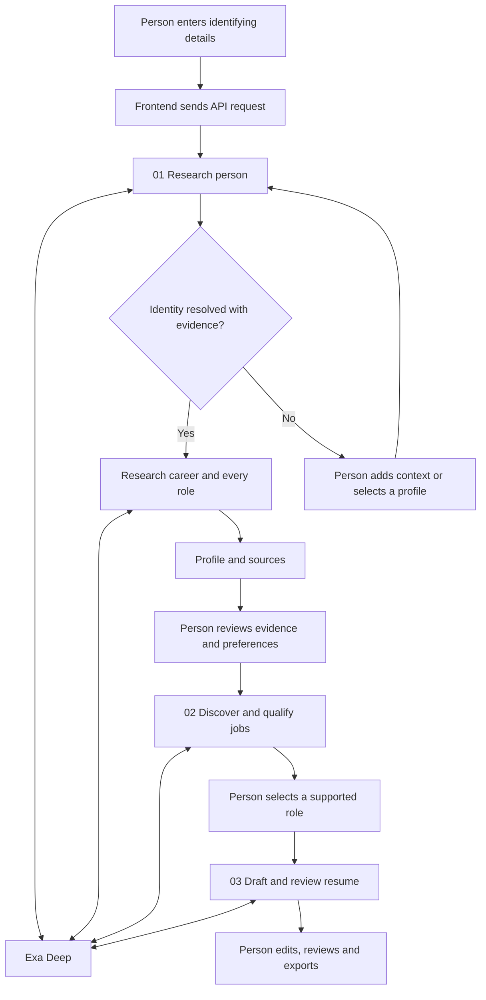

# How the code works

Start with the three numbered files in [backend/workflows](../src/backend/workflows/). A workflow is a short recipe: it names the steps, calls the files that perform them, and returns the result. You do not need to understand every API detail before reading the recipe.

This project has three main areas:

- **Frontend:** what the person sees and interacts with in their browser.
- **Backend:** code that runs on the server, including research and Exa credentials.
- **Shared:** data definitions and small functions used safely by either side.

## Follow one journey

The arrows through the person are real checkpoints. Research does not automatically confirm facts, select a job, or export a resume. Each numbered workflow starts from its own API request.

## 1. Research the person

Entry point: [01-research-person.ts](../src/backend/workflows/01-research-person.ts).

**Input:** identifying text, such as a name with a profession, employer, or profile link. **Output:** a researched profile when the identity is resolved; otherwise an inline question or sourced choices. The profile contains employment entries, candidate claims, sources, research receipts, and unresolved gaps.

1. Validate the starting text before making a paid request. Every valid nonempty query goes to Deep; the app does not use a word count to decide whether a person is identifiable.
2. [resolve-identity.ts](../src/backend/features/candidate/resolve-identity.ts) asks Deep to resolve the professional identity using its own research loop: compare supplied details with public evidence, inspect contradictions, and refine as needed. The schema requests `resolution`, `question`, and possible profiles with a grounded `matchEvidence` explanation.
3. If Deep explicitly reports a resolved identity, returns exactly one original candidate with grounded name and matching-context evidence, and has no unresolved question, the same backend workflow continues automatically. One result by itself is insufficient. Unsupported, contradictory, or malformed output returns to clarification; the app does not run another search-planning loop.
4. Only if unresolved, [identity-step.tsx](../src/frontend/features/candidate/identity-step.tsx) displays the question and choices in the original input card. Adding a detail sends the expanded context back to Deep, which may now resolve the person without a selection click. Selecting **This is me** supplies a server-signed token tied to the offered choice and original query. It expires after 15 minutes or a server restart and is not account authentication. Unresolved identity blocks downstream actions. A browser refresh clears the flow and starts again.
5. [identify.ts](../src/backend/features/candidate/identify.ts) asks Deep for the resolved or selected person's professional history. The workflow checks the returned name and anchored-profile grounding before continuing. An inconsistent identity returns to clarification. Exact name matching is conservative: an unverified display-name variation may need another lookup.
6. [work-history.ts](../src/backend/features/candidate/work-history.ts) sends a focused Deep request for every identified employment entry, up to ten entries. Two requests can run at once. Older roles are researched even when some facts were already found.
7. [evidence.ts](../src/backend/features/candidate/evidence.ts) manages claims, source context, and coverage. It preserves gaps instead of inventing responsibilities.

The expected response shapes live in [candidate/schemas.ts](../src/backend/features/candidate/schemas.ts). A schema describes the fields Deep should return. It does not prove that the returned facts are true.

Deep performs the research and produces a structured resolution assessment with field-level grounding. The assessment is an application-requested output, not an Exa identity-verification signal. Its [documented Search API](https://exa.ai/docs/reference/search) has no human-confirmation or pause-and-resume contract. The app displays a follow-up only when needed, then supplies the added context to a new Deep request. Neither a single result nor high field confidence guarantees the person's intended identity.

The profile appears in [profile-screen.tsx](../src/frontend/features/candidate/profile-screen.tsx) with every researched contribution selected. The person can deselect or edit details and immediately choose **Find roles** with **Open to suitable roles** and **Any location**. There is no profile-review checkbox. Only selected claims are passed into matching and drafting; selection does not certify their truth. A completed research request does not mean the entire career history has been recovered.

## 2. Find relevant jobs

Entry point: [02-find-relevant-jobs.ts](../src/backend/workflows/02-find-relevant-jobs.ts).

**Input:** the selected profile evidence, desired role/location, and employer exclusions. **Output:** qualified opportunities with requirement-to-evidence mappings, gaps, and receipts.

1. Validate the selected evidence and preferences. The legacy `confirmed` field means selected for use; it does not record manual review or factual verification.
2. [discover.ts](../src/backend/features/jobs/discover.ts) asks Deep for potential openings. The requested function controls the search. Previous job titles do not replace that choice. Current employers, or the most recent employer if none is current, are removable default exclusions. Earlier employers are not automatically excluded.
3. [qualify.ts](../src/backend/features/jobs/qualify.ts) makes one additional Deep request to inspect the shortlist's primary postings. It separates direct, transferable, and missing evidence for each requirement.
4. Application checks withhold roles whose returned assessments fail the fit rules. They can return zero matches.

The fit rules require grounded posting information, at least two directly supported core responsibilities. Unknown or transferable required qualifications remain visible as gaps; these opportunities are potential matches, not a claim of complete qualification. Reviewed employment history can support date/title requirements; it cannot establish a core skill just because the person held a title.

This is a conservative product rule, not a hiring prediction or an ATS score. Deep can still misunderstand requirements or evidence, so the mapping is available for review in [jobs-screen.tsx](../src/frontend/features/jobs/jobs-screen.tsx).

## 3. Create and review the resume

Entry point: [03-create-resume.ts](../src/backend/workflows/03-create-resume.ts).

**Input:** a qualified selected job and selected candidate experience. **Output:** reviewed resume content, the evidence and requirement IDs behind its bullets, and research receipts.

1. [draft.ts](../src/backend/features/resume/draft.ts) checks that the job has a current-format qualification assessment and that useful work evidence exists.
2. Deep researches the selected role and drafts supported, relevant wording. Each bullet must link to selected evidence and an assessed job requirement.
3. [review.ts](../src/backend/features/resume/review.ts) sends a separate Deep request to check factual meaning, relevance, and employer attribution. For example, collaboration with a product team must not become ownership of a product roadmap.
4. The workflow removes unsupported material. Independent work remains separate when its employer relationship is not established.

[shared/resume/document.ts](../src/shared/resume/document.ts) assembles the document data and text export. [resume-preview.tsx](../src/frontend/features/resume/resume-preview.tsx) renders that data as selectable text. Employers with selected contributions get detailed sections; other useful history is compact.

The writing guideline is 2–4 bullets for a recent relevant role and 6–8 total when evidence supports them. Eight is the generated draft cap, not a requirement to fill every slot. Email and a LinkedIn profile URL are required before export. The summary is optional if its claims cannot be supported. The person reviews the final content before printing or copying it.

## Find the right file

| If you want to understand… | Read… |
|---|---|
| How screens and user actions connect | [frontend/main.tsx](../src/frontend/main.tsx) |
| What appears on the first screen | [start-screen.tsx](../src/frontend/features/start/start-screen.tsx) |
| How a browser request receives progress | [browser/research-stream.ts](../src/frontend/browser/research-stream.ts) |
| Workspace defaults and identity follow-up helpers | [browser/workspace.ts](../src/frontend/browser/workspace.ts) |
| Which URL starts candidate research | [app/api/research/route.ts](../src/app/api/research/route.ts) |
| The order of backend work | [backend/workflows](../src/backend/workflows/) |
| How incoming data is checked | [backend/validation.ts](../src/backend/validation.ts), [http/request.ts](../src/backend/http/request.ts) |
| How results and progress reach the browser | [http/response.ts](../src/backend/http/response.ts) |
| How an Exa request is built and sent | [providers/exa/deep.ts](../src/backend/providers/exa/deep.ts) |
| How actual Exa events are parsed | [providers/exa/stream.ts](../src/backend/providers/exa/stream.ts) |
| How findings, citations, and page excerpts are retained | [providers/exa/response.ts](../src/backend/providers/exa/response.ts) |
| Request quotas and timeouts | [providers/exa/limits.ts](../src/backend/providers/exa/limits.ts) |
| What a profile, job, or resume contains | [shared/types.ts](../src/shared/types.ts) |
| How the requested job function is interpreted | [shared/jobs/role-intent.ts](../src/shared/jobs/role-intent.ts) |
| Email and LinkedIn checks | [shared/resume/contact.ts](../src/shared/resume/contact.ts) |

### Why `app/` is separate

Next.js discovers pages and API endpoints through `app/`. [app/page.tsx](../src/app/page.tsx) opens the frontend, while files under `app/api/` connect URLs to backend workflows. These are thin framework entry points. The folder is not middleware: middleware would intercept a request before its route runs.

### Why features and providers are separate

A feature decides **what to research and what counts as acceptable output**. The Exa provider handles **how to send the request, read its response, and report failures**. This keeps a job-matching rule easy to find without reading HTTP code, and makes API behavior easy to inspect without reading resume prompts.

Shared code contains no Exa credentials or server network calls. UI components live under `frontend/`; provider calls live under `backend/`. Both sides can use shared data definitions and document utilities.

### How long the workspace lasts

[frontend/main.tsx](../src/frontend/main.tsx) holds the workspace in React state. Moving between Start, Profile, Jobs, and Resume keeps that state in the current page. Refreshing the browser, closing the page, or opening a new tab starts a blank search. **New search** resets the current flow; **Stop** cancels a request while retaining existing work in the open page.

The app does not load or save workspace data in browser storage. On startup it removes only the older workspace key and its migration-backup key. Other browser storage is left alone. Exported or copied resumes remain wherever the user saved them.

## There are two different streams

**Exa → backend:** the provider's synthesis stream reports events such as source results, generated output beginning, citations, reset, completion, or error. [providers/exa/stream.ts](../src/backend/providers/exa/stream.ts) parses those events. Only the completed response becomes authoritative output. See [Exa Deep streaming](https://exa.ai/docs/search/deep-search) and [Exa's event reference](https://github.com/exa-labs/agent-skills/blob/main/skills/build-with-exa/references/search.md).

**Backend → browser:** the application sends `activity`, `complete`, and `error` events. Activities can originate from Exa or the application. The application knows, for example, that it has started a request for a particular employer. That does not mean Exa exposed which internal query it is running. [activity-feed.tsx](../src/frontend/components/activity-feed.tsx) labels these origins separately and keeps technical details expandable.

The elapsed clock measures time. It is not a completion percentage. Keep-alive messages maintain the connection; they do not invent progress. Deep's internal reasoning and expanded-query trace are not available through the documented synthesis events.

## What Deep does, and what remains uncertain

Every research and review call explicitly uses `type: "deep"`. Deep performs iterative search and synthesis inside Exa's `/search` endpoint. The application supplies focused queries and schemas, preserves field-level grounding, and applies its own validation and confirmation rules. No agent framework is required for this flow. [Deep Search documentation](https://exa.ai/docs/search/deep-search)

Deep can research public evidence across sources; it cannot guarantee access to private LinkedIn details, private repositories, unpublished work, or every page about a person. Returned page excerpts are bounded context, not a complete archive. Citations and a second model review improve inspectability but do not guarantee truth. The same limits apply to job availability and requirements.

A full successful journey with **N employment entries uses N + 6 Deep calls**: one identity resolution, one career call, N work-history calls, one discovery call, one batch qualification call, one draft call, and one review call. Ten employment entries means up to 16 calls before extra lookups, refreshes, or retries. A valid bare-name query now makes one Deep call and stops if unresolved. Delegating that judgment to Deep adds latency and cost compared with a local name heuristic. Actual provider receipts record reported cost when available.

Important bounds are kept visible in code:

- Two concurrent work-history requests per person; the server process defaults to 24 active Deep operations and 300 HTTP attempts per rolling hour, shared by all users. `EXA_MAX_CONCURRENT_REQUESTS` and `EXA_MAX_REQUESTS_PER_HOUR` configure these limits. Admission is immediate, with no waiting queue.
- An actual Exa HTTP 429 can be retried twice, honoring `Retry-After` with added jitter or using exponential jitter when it is absent. Each HTTP attempt counts toward the budget. Other HTTP errors and partial streams are not retried.
- Each Deep operation has one 150-second timeout including retries and backoff. Stop cancels the work. API route duration settings are 960 seconds for candidate research and 360 seconds for each later workflow. Hosting platforms may impose different limits.
- Schemas use at most ten properties in total, including nested fields. Ten returned source pages does not mean Deep ran only ten internal searches.
- Candidate source excerpts are capped at 40,000 characters overall, with a smaller allowance in downstream candidate context. API request bodies are limited to 400 KB.

A production deployment may need durable background jobs, resumable progress, shared quotas, and user-owned storage. The current in-memory workspace and in-process limits are for the local MVP.

## How to check a change

Run `npm run typecheck`, `npm test`, and `npm run build` from the project root. Node discovers the nested test suites automatically:

- [tests/backend](../tests/backend/): workflows, feature rules, provider responses, and failure cases.
- [tests/frontend](../tests/frontend/): browser streaming and rendered interface behavior.
- [tests/shared](../tests/shared/): reusable role, contact, and document logic.

Tests use controlled provider responses. A passing test or build does not prove that a real Deep search found the right person or that a live resume is good. Follow [the acceptance checklist](../tests/acceptance.md) to test real searches, browser interactions, and exported documents. Live end-to-end success has not been established by this reorganization.
